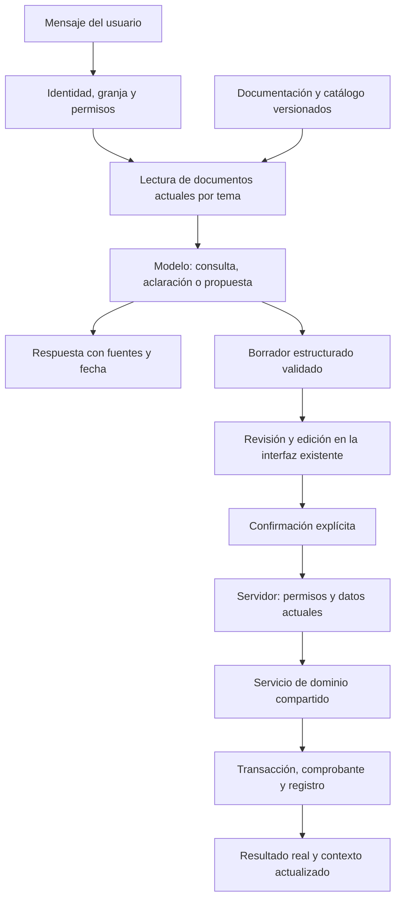

# Asistente operativo de Mi Granja

Estado: **implementación de la primera versión operativa en el código; requiere las comprobaciones de integración indicadas abajo antes de publicar**. El asistente prepara propuestas persistidas y el usuario las revisa y confirma. El historial de conversaciones continúa guardado localmente por usuario y granja; no hay sincronización de chats entre dispositivos.

## Objetivo

Que el usuario pueda consultar su granja y preparar movimientos hablando con el asistente: altas, pendientes de destete, revisión de montas y, progresivamente, los demás registros. Debe recibir el mismo resultado y conservar el mismo historial que al usar los flujos normales.

El asistente interpreta y prepara; el sistema valida y ejecuta. Una respuesta del modelo no demuestra que ocurrió una operación. Solo un comprobante persistido permite responder «guardado».

## Documentación canónica

- [Conocimiento y archivos](knowledge.md): fuentes, organización, actualización y permisos.
- [Catálogo de acciones y flujos](flows.md): formularios, reglas y condiciones de cada operación.
- [Historial de decisiones](CHANGELOG.md): qué cambió, por qué y qué queda pendiente.

Esta carpeta es la entrada única para el diseño del asistente. Los tipos, validaciones y servicios compartidos siguen siendo la autoridad ejecutable; no copiar sus reglas en instrucciones independientes. El código y esta documentación se actualizan juntos.

## Implementación actual y límites

| Área | Implementado en esta versión | Límite o comprobación pendiente |
| --- | --- | --- |
| Conocimiento | `buildAiKnowledge` publica documentos por tema, instante, fuentes, permisos, cobertura y cursores; vuelve a leer Firestore en cada consulta | Lee las fuentes completas antes de paginar la respuesta; `read_document` permite hasta cuatro pasos de recuperación controlada; no hay búsqueda vectorial ni archivos arbitrarios |
| Historial real | Integra `animals.records`, `animalRecords` y comprobantes `recordMovements`, deduplica por ID e interpreta reversiones | Una fuente que falle hace fallar la consulta; no se presenta como resultado vacío |
| Fechas | Días de negocio calculados con zona efectiva: configuración de granja, zona válida del navegador o fallback UTC | Revisar con usuarios la zona de cada granja y probar cambios de día; UTC es un fallback explícito |
| Catálogo | Diez operaciones versionadas en `lib/ai/operations.ts`; catálogo visible filtrado por permisos | Cada nueva acción exige esquema, servicio, documentación y pruebas; no puede agregarse solo al prompt |
| Propuestas | `aiActionProposals` en servidor, usuario/granja/conversación, revisión, caducidad de 15 minutos y huella de estado | Las conversaciones locales no son la autoridad del estado de la propuesta |
| Revisión | Tarjetas `ProposalCard` y editor tipado `OperationFields` en el modal compartido; resumen y efectos obtenidos del servidor | Esta entrega no monta todos los formularios originales dentro del chat. Reutiliza los servicios de dominio que también consume la UI; la equivalencia debe comprobarse por acción |
| Ejecución | Revalida permisos, revisión, versión, datos actuales y comprobante dentro de la transacción; aplica servicios compartidos | Confirmar en emulador los casos de concurrencia, conectividad, reversión y permisos de las diez operaciones |
| Retiro del sistema anterior | `executeAiAction` y escrituras directas antiguas retirados; `confirm-action` recibe operaciones sobre propuestas nuevas | Las solicitudes antiguas reciben HTTP 410. `aiActionLogs` es histórico, no una fuente para ejecutar comandos |
| Mantenimiento | `manifest.json`, `pnpm check:assistant-docs`, pruebas del guard y paso en `pnpm review` | Para revisar una rama completa usar `pnpm check:assistant-docs --base <referencia>`; no hay una integración alojada de CI nueva |

Fuentes: `apps/dashboard/src/lib/ai/{knowledge,operations,proposals}.ts`, `lib/domain/`, `components/assistant/` y las rutas `app/api/ai/`.

No hay fallback al ejecutor anterior. Las propuestas antiguas de `aiActionLogs` ya no son ejecutables; sus documentos y los registros históricos se conservan. Las propuestas nuevas pertenecen al catálogo versionado y una versión incompatible exige preparar una nueva.

## Arquitectura objetivo

La confirmación es parte del producto para cada movimiento. No agregar un segundo sistema de confirmaciones si el formulario existente ya muestra todos los datos y tiene su botón Guardar.

## Protocolo para realizar una acción

1. **Entender la intención.** Diferenciar consulta de escritura. «¿Cuándo se desteta A7?» no autoriza un destete. «Désteta A7 a engorda hoy» prepara ese movimiento.
2. **Consultar el estado.** Resolver referencias dentro de la granja y con permisos actuales. Si un número o nombre coincide con varios animales, pedir elección; no usar el primer resultado.
3. **Completar datos.** Pedir solo los obligatorios que falten. Una fecha estimada de destete o parto no significa que el evento haya ocurrido. Los valores propuestos como estimados deben verse como tales y ser editables.
4. **Preparar un borrador tipado.** El servidor valida el tipo de acción, campos, referencias, compatibilidad y permisos antes de ofrecer ejecutarla. El modelo nunca selecciona rutas de Firestore ni escribe código ejecutable.
5. **Revisar.** Mostrar animales, fecha, destino y efectos relacionados. Abrir el formulario/modal existente con esos datos; mantener la conversación disponible al cancelar o cerrar el formulario.
6. **Confirmar y revalidar.** El servidor recibe el identificador del borrador, sus ediciones permitidas y su revisión. Vuelve a leer permisos y documentos; verifica que la granja siga siendo la misma. Si cambió un dato relevante, devuelve una propuesta actualizada para revisar, sin aplicar parcialmente.
7. **Ejecutar una vez.** Usar un identificador estable para el comando y su movimiento. Un reintento o doble clic consulta el comprobante existente; nunca crea un movimiento nuevo para la misma confirmación.
8. **Devolver evidencia.** Mostrar el resultado confirmado, fecha, animales y enlace al registro. Actualizar los datos visibles y regenerar el contexto de la siguiente consulta. Si falló o quedó incierto, informar ese estado, sin afirmar que se guardó.

## Contratos y estados

- `KnowledgeDocument`: ruta lógica, versión del esquema, instante de lectura, fuentes, disponibilidad y cobertura, contenido, cursor si hay más resultados.
- `ActionDefinition`: identificador, versión, esquema de entrada, permisos de lectura/escritura, resolutor de entidades, validación, efectos, formulario de revisión y ejecutor de dominio.
- `ActionProposal`: ID del servidor, usuario, granja, conversación, revisión, versión del flujo, datos normalizados, campos faltantes, documentos/revisiones usados y vencimiento. Conservarla en servidor; no confiar en una copia modificada en localStorage.
- `ActionReceipt`: ID del comando, estado real, movimiento/documentos creados, actor, fecha y resultado. No almacenar claves del proveedor ni datos de otra granja.

Estados persistidos/expuestos en esta versión: `ready`, `succeeded`, `cancelled`, `expired` y `conflict`. La recopilación de datos ocurre mediante aclaraciones antes de crear una propuesta. La ejecución y su comprobante se confirman en una transacción; no existe un estado persistido `executing` que se libere para repetir escrituras a ciegas. Ante error de red después de confirmar, consultar de nuevo el mismo ID. Una edición incrementa la revisión y exige revisar esa versión. Caducidad: 15 minutos; siempre revalidar al ejecutar, incluso antes de ese plazo.

`failed` y `reconciling` quedan como posibles ampliaciones para tareas asíncronas futuras, no como estados ya implementados.

El cliente confirma el borrador del servidor. No debe enviar una acción arbitraria que sustituya la propuesta almacenada. El endpoint antiguo acepta una acción completa del cliente: debe revisarse antes de reutilizarlo.

## Secuencia y criterios de aceptación

| Fase | Entregable | Criterio de salida |
| --- | --- | --- |
| 1. Conocimiento vigente | Documentos por tema, índice, fuentes, disponibilidad, páginas y reglas tomadas de configuración | Responde correctamente sobre animales, montas y destetes; indica faltantes y recortes; respeta permisos; no usa el chat como estado actual |
| 2. Infraestructura de borradores | Catálogo tipado, propuesta persistida, revisión en modal, estados, comprobantes e idempotencia | Se pueden preparar/cancelar borradores sin escritura; permisos y conflictos se comprueban en servidor; nunca se ejecuta texto libre |
| 3. Alta de animales | Una primera acción completa, con formulario actual precargado y servicio de alta compartido | Alta por chat y alta manual crean el mismo animal y registro, con duplicados, fechas y etapa validados |
| 4. Destetes | Consultar pendientes, seleccionar animales, fecha y destino, ejecutar movimiento actual | Actualiza crías y efectos sobre madres como el flujo manual; no repite destetes y conserva reversión |
| 5. Empadres | Revisar montas, preparar nuevas montas y confirmar gestaciones mediante flujos actuales | Compatibilidad y disponibilidad se revalidan; terminar un empadre y liberar al macho se explica en la revisión |
| 6. Resto de movimientos | Partos, leche, peso, salud y ventas, uno a uno | Cada acción supera pruebas de equivalencia y trazabilidad antes de habilitarse |

Las fases 1 a 6 tienen implementación inicial en código: el catálogo incluye altas, destetes, empadres, gestaciones, partos, peso, leche, salud y venta. La tabla anterior define el orden de validación y los criterios de salida, no afirma que todos los escenarios operativos estén ya comprobados en producción.

En el alta por asistente, esta versión cubre «Nuevo». «Parto» y crear una madre son operaciones relacionadas: habilitarlas tras definir qué constituye un parto real y la atomicidad de los documentos involucrados. No confundir vincular una madre con registrar un parto, ni prometer que cancelar la cría elimina una madre ya creada.

Eliminar animales, deshacer movimientos y operaciones destructivas se posponen hasta tener autorización, revisión y dependencias del historial cubiertas. Las consultas de pendientes y montas pueden funcionar desde la fase 1.

## Criterios de aceptación transversales

- Misma operación por UI o asistente: mismos campos persistidos, estados, registros y efectos relacionados.
- Cambiar de granja, cambiar de usuario o perder permisos invalida una propuesta incompatible.
- Permisos de un módulo no permiten inferir detalles de otro módulo restringido.
- Un animal vendido, muerto, borrado o cambiado después de preparar la acción debe revisarse de nuevo.
- Fechas según la zona horaria efectiva de la granja y el fallback explícito documentado; el contexto de ejecución transporta `timeZone` hasta los servicios de calendario. No interpretar «hoy» usando la zona del servidor por accidente.
- Pérdida de red, doble clic, reintentos y caída después de guardar no duplican movimientos.
- Una acción masiva informa todos los animales y sus efectos. No hay éxito parcial silencioso; si excede límites transaccionales, dividir explícitamente en operaciones revisables.
- Notas, nombres y mensajes son datos, no instrucciones para modificar permisos o saltarse el protocolo.
- El historial conserva la tarjeta y el estado de la acción. Reabrir un chat no vuelve a ejecutarla.
- No depender de pruebas con un modelo real para demostrar seguridad o integridad. Probar validadores, servicios y permisos de forma determinista; usar casos de conversación para evaluar interpretación.

## Mantenimiento obligatorio

Cuando cambie un flujo, su PR/commit debe incluir lo que corresponda:

1. Actualizar [flows.md](flows.md), reglas y enlaces de interfaz.
2. Actualizar [knowledge.md](knowledge.md) si cambian fuentes, campos, cálculos o permisos.
3. Cambiar el contrato ejecutable compartido y su versión si cambia la entrada o el efecto. Las propuestas antiguas incompatibles deben caducar.
4. Regenerar el conocimiento estático utilizado por el modelo a partir del catálogo; no editar otra copia del mismo flujo en el prompt.
5. Añadir o ajustar pruebas de la acción, de equivalencia manual/asistente y de contexto.
6. Registrar la decisión en [CHANGELOG.md](CHANGELOG.md) y marcar el estado real de la fase.

Responsabilidad: quien cambie el flujo actualiza su integración y documentación. La revisión debe comprobar ese impacto. La automatización local `pnpm check:assistant-docs` comprueba versiones, IDs del catálogo, fuentes y documentación modificada. Está integrada en `pnpm review`; `pnpm test:assistant-docs` verifica el guard. Para una rama completa, pasar `--base <referencia-git>`.

Si cambia el esquema de entradas de `operations.ts` respecto a la referencia de Git, el guard exige incrementar `OPERATION_VERSION`, invalidando propuestas antiguas. Sin `--base`, revisa los cambios locales contra HEAD; por sí solo no audita una rama ya confirmada. El manifest y el guard no reemplazan las pruebas de negocio ni pueden deducir automáticamente todos los cambios semánticos.

Cambios que activan esta revisión: formularios de animales/registros/empadres, validadores, tipos compartidos, permisos, transacciones y reversión, configuración reproductiva, reglas de fechas, navegación y respuesta del proveedor de IA.

## OpenAI mediante OpenRouter (BYOK)

El proveedor por defecto es OpenRouter con el modelo `openai/gpt-6-luna-pro`. Las solicitudes de modelos `openai/*` restringen el proveedor interno a `openai` y desactivan sus fallbacks de enrutamiento. La clave utilizada por la app sigue siendo `OPENROUTER_API_KEY`; la credencial de OpenAI se administra en BYOK de OpenRouter. Los modelos guardados explícitamente en Admin o `OPENROUTER_MODEL` conservan prioridad sobre el valor por defecto.

La restricción de no consumir capacidad compartida se configura en el panel BYOK de OpenRouter; el código no puede reemplazar esa política de cuenta. Para verificar la ruta, revisar `is_byok` en los metadatos de una generación exitosa. Un error que indique que ninguna clave BYOK puede servir el modelo requiere revisar en OpenRouter que la clave esté habilitada, priorizada, permita ese modelo y pertenezca al mismo workspace que la clave de la app.

No confundir crear una credencial en OpenRouter con comprobar su funcionamiento. La prueba local del 2026-11-01 con `openai/gpt-6-luna-pro` devolvió HTTP 200 y proveedor `OpenAI`, con respuesta recibida. El modelo anterior Sol estaba excluido por el filtro BYOK del usuario. Los metadatos consultados no devolvieron `is_byok`; la verificación no confirma saldo ni vinculación de créditos Pro.

Compatibilidad del proveedor: el esquema estricto normaliza límites numéricos exclusivos a valores numéricos JSON Schema. La validación Zod conserva los límites de dominio. Probar una solicitud con el esquema completo, además de un saludo sin esquema, antes de dar por verificada una conexión nueva.

Los identificadores y nombres únicos de animales mencionados en el chat abren su modal de detalles sobre la conversación. Solo se enlazan coincidencias exactas e inequívocas de la granja actual. El cierre de la ficha conserva el chat abierto.

Los códigos únicos de empadre mencionados en el chat abren una ficha compacta sobre la conversación, con fecha, estado, macho y hembras agrupadas mediante los helpers actuales de empadres. Los animales de la ficha abren sus detalles conservando ambos contextos. Se resuelven solo registros de la granja actual; las referencias ambiguas entre animales y empadres no se enlazan como empadres. No ejecuta movimientos.

La ficha de empadre del chat permite confirmar gestación de hembras pendientes, sacar participantes y registrar parto de gestantes. Reutiliza `ModalConfirmPregnancy`, `ModalBirthForm`, `useBreedingHandlers` y los movimientos compartidos. Respeta permisos; sacar requiere confirmación explícita y advierte si eliminará todo el empadre. Confirmar gestación o parto conserva la ficha y el chat; eliminar el empadre cierra su ficha.

En la ficha del empadre, el botón (+) junto a Hembras abre un selector múltiple de hembras disponibles de la especie del macho. Excluye participantes actuales, animales inactivos, gestantes, paridas y ocupadas en otros empadres activos. Agrega mediante `updateBreedingRecord`, preserva la información de las hembras existentes y mantiene la ficha abierta. Solo aparece con permiso de actualización y en empadres en curso.
